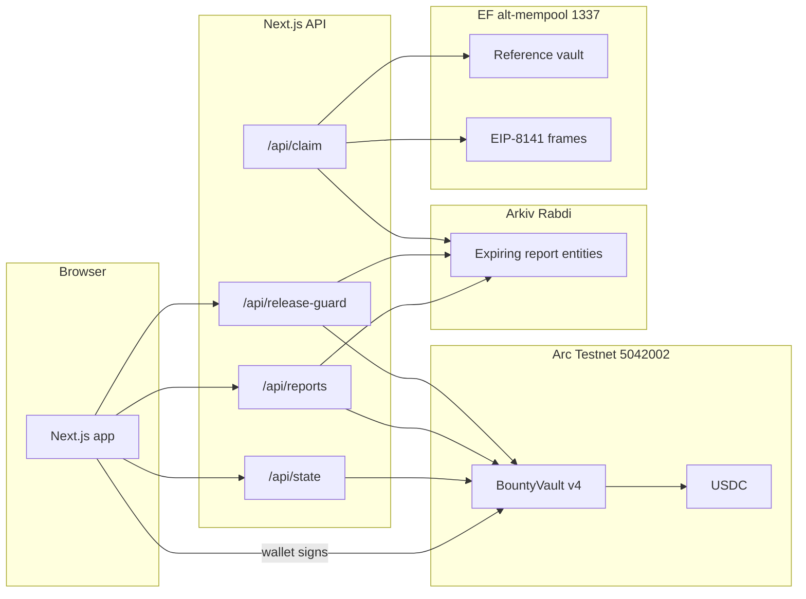
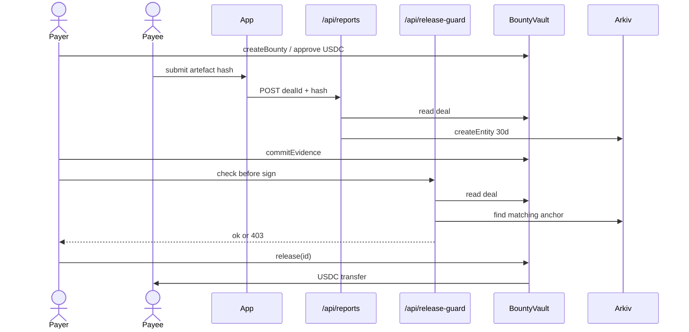
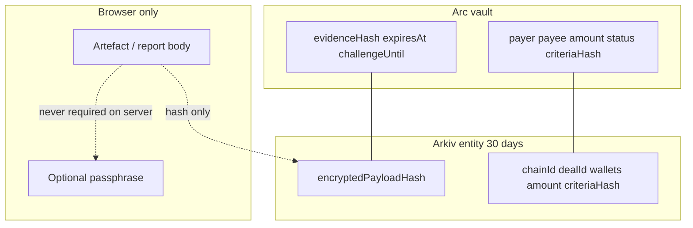

# ClearAudit

Settlement for situations where you cannot safely trust the other side with custody, and you cannot safely leave a permanent paper trail either.

One party locks a fixed amount of USDC in a vault on Arc Testnet. The other side delivers an artefact and anchors only a fingerprint, with a thirty day expiry, on Arkiv. Money leaves the vault only when a live fingerprint matches the on-chain terms (payee, payer, amount, criteria). Anyone can re-run that check at `/evidence` without a wallet. After thirty days the fingerprint stops being served. The chain still shows who got paid.

Bug bounties and freelance invoices are possible on this rail. They are not the story. The story is incident settlement: recovery after an exploit, coordinated disclosure, a retainer deliverable under NDA, an agent task, a contest prize. Same vault. Different nouns.

Live on **Arc Testnet** (chain `5042002`). Built for ETHGlobal Mumbai with Arc, Arkiv, and the Ethereum Foundation Alternative Mempool each carrying a real piece of the problem.

- Site and app: `frontend/`
- Public evidence (no wallet): `/evidence?dealId=0`
- Workspace: `/app`

## The problem

I have been on the wrong side of custody more than once.

With exchanges and lending platforms (WazirX, Vauld among them), funds sat behind someone else's process while I waited. As a freelancer I have placed work with clients on trust and watched payment depend on goodwill rather than a rule both sides could verify. The pattern is the same: one party holds the money or the leverage, the other party has to believe them, and any record that proves the deal either never exists or lives forever in someone else's database.

ClearAudit is my answer to that pattern. Lock the amount where neither of us can redirect it. Require a public, time-bounded fingerprint before release. Let anyone re-check the match. Let the sensitive evidence expire.

## What it does

1. **Fund.** Name a payee and lock USDC, open a task any agent can claim, or open a contest with a prize pool. The vault records payer, amount, deadline, and criteria hash.
2. **Anchor.** Only a hash (and metadata that matches the deal) is written to Arkiv for thirty days. The artefact body stays local unless the user exports it.
3. **Commit on chain.** `commitEvidence` stores the fingerprint on the vault with an expiry and a challenge window.
4. **Release.** The payer calls `release(id)` (no recipient argument), or after the challenge window anyone may `settleAfterChallenge`. Contests use `award` so a judge can split the pool across registered entrants. The application gate (`/api/release-guard`) and the public page (`/evidence`) both re-read Arc and Arkiv before treating a payout as justified.
5. **Dispute.** Either party can freeze an open deal. The immutable arbitrator resolves to exactly one side.

## Architecture

### System context



The Arc vault is the product. The EF path is a separate research artifact on chain 1337. It is not a bridge and no value moves between the two networks.

### Happy path (named deal)



### Where data lives



## Partners (why each one)

| Partner | Track | Why it fits this problem |
| --- | --- | --- |
| **Arc** | Best Smart Contracts with Advanced Stablecoin Logic (lead); Best DeFi / Onchain Finance App | USDC is gas and settlement. The payee of a named deal never has to hold a separate gas token. Contracts were built and deployed with [Arc Studio](https://studio.arc.io/app/3505cc60-6a37-442c-8b75-9a4d516007c1). |
| **Arkiv** | New app whose data lives in Arkiv | The fingerprint that gates payout must expire. That is a storage property on Rabdi, not a cron job I promise to run. Track notes: [`arkiv/`](arkiv/). |
| **Ethereum Foundation** | Alt mempool / EIP-8141 (lead); CROPS as backup | The person being paid should not need a funded wallet to finish settlement. On the alt-mempool devnet the researcher is a beneficiary in the frame calldata, never `tx.sender`. Demo: `/app/gasless`. |

### Arc and Arc Studio

My smart contract experience is basic. This idea needs a real vault (roles, deadlines, evidence, contests, disputes), not a toy escrow. I used Arc Studio to design, test, and deploy that surface end to end from the product idea I brought in. Arc Testnet made USDC-native deployment straightforward, so settlement and gas are the same asset. Later vault revisions also went out with Foundry when Studio quota was exhausted. Same sources, same network, no proxy.

### Arkiv

If the gate lived in my Postgres, "does this deal have evidence?" would mean "trust my server." Arkiv holds a thirty day entity anyone can query. I used Arkiv agent skills so the coding agent could wire the SDK while I worked through Arkiv's developer docs for the schema, indexing, and write path this use case actually needs. Schema and rationale live in [`arkiv/`](arkiv/).

### Ethereum Foundation (EIP-8141)

On Arc the payee of a named deal already never signs. The EF artifact pushes the same idea further on the alt-mempool: a frame transaction where validity sits in the transaction itself, the protocol relayer pays gas, and the researcher never participates in the fee market. The same Arkiv gate runs before any frame is built.

Honesty on the current devnet revision: a contract paymaster cannot sit in a PAYMENT frame. Gas is paid by `tx.sender` (the relayer). We are not claiming ERC-4337 sponsorship on Arc. CROPS backup if judges ask for a public-mempool story: `/evidence` plus the fail-closed application gate.

## Deployed on Arc

| Item | Value |
| --- | --- |
| `BountyVault` v4 | [`0x9D500710df8036e4BdF38Bf9A6CA7364Cd4e26C1`](https://explorer.testnet.arc.io/address/0x9D500710df8036e4BdF38Bf9A6CA7364Cd4e26C1) |
| Deploy tx | [`0xab6a72fd…12f4`](https://explorer.testnet.arc.io/tx/0xab6a72fd3d01761e46a07b71237af4c2d9c202805ab3bce321440165326e12f4) (block 71038680) |
| USDC | `0x3600000000000000000000000000000000000000` |
| Arbitrator | `0x65B555dDAd787B66F3F1E4Dd4Ff814D11B9A0ed2` |
| Challenge window | 300 seconds |

`release(id)` requires live committed evidence. Contests use `award`. After the challenge window, anyone may `settleAfterChallenge` on a single-payee deal.

Earlier vaults (v1 to v3) remain on chain and readable. The app points at v4. Full seed and history: [`deployments.arc.json`](deployments.arc.json).

### Seed workspace (live deals)

| Deal | Situation | Notes |
| --- | --- | --- |
| [#0](/evidence?dealId=0) | Recovery | Open, Arkiv match, evidence committed |
| [#1](/evidence?dealId=1) | CVD / PSIRT | Open, Arkiv match |
| [#2](/evidence?dealId=2) | Retainer | Open, Arkiv match |
| [#3](/evidence?dealId=3) | Agent dispatch | Open task, unclaimed |
| [#4](/evidence?dealId=4) | Contest | Awarded to two registered entrants |

`npm run verify:chain` re-reads the deployment from public RPC and fails on mismatch.

| Screen | Path |
| --- | --- |
| Landing | `/` |
| Workspace | `/app` |
| Public evidence | `/evidence?dealId=0` |
| EF gasless demo | `/app/gasless` |

## Run locally

```bash
npm install
npm --prefix frontend install
npm run build
npm run verify:chain
npm --prefix frontend run dev
```

Create `frontend/.env.local` (see `frontend/.env.example`):

```ini
NEXT_PUBLIC_ARC_RPC_URL=https://rpc.testnet.arc.io
NEXT_PUBLIC_VAULT_ADDRESS=0x9D500710df8036e4BdF38Bf9A6CA7364Cd4e26C1
NEXT_PUBLIC_USDC_ADDRESS=0x3600000000000000000000000000000000000000
NEXT_PUBLIC_ARBITRATOR_ADDRESS=0x65B555dDAd787B66F3F1E4Dd4Ff814D11B9A0ed2

ARKIV_PRIVATE_KEY=
ARKIV_ACCESS_KEY=
REQUIRE_ARKIV_ANCHOR=true
PROTOCOL_PRIVATE_KEY=
```

`ARKIV_ACCESS_KEY` is free at <https://hub.arkiv.network/access-keys>. Foundry tests need `forge install foundry-rs/forge-std` (`lib/` is not vendored).

## Known limitations

- Once an open task is claimed, the payer cannot cancel. Routes are dispute or wait for `refundExpired`.
- A disputed deal needs the arbitrator key to resolve.
- No upgrade path and no admin withdrawal. A bug is not patchable in place.
- Task discovery is out of band. The chain holds the task; nothing pings agents to look.
- Named deals pay one address. Contests are the split path (`award`, max eight winners).

## How this was built

The problem is mine. I have watched custody and trust fail in exchanges (WazirX, Vauld), and I have watched the same pattern as a freelancer waiting on clients. ClearAudit is the settlement rule I wanted in those moments: lock the amount, require a public fingerprint that expires, let anyone re-check the match.

I used a few tools in sequence. Locally I ran **Hermes** with **DeepSeek V4.1 Flash 1017** for most of the ideation, for hunting down the critical pieces of documentation, and for the v1 build. I used **Pi** (coding agent) with the same DeepSeek model to refine the build from v2 into v3. **Grok 4.6 (Medium)** helped polish the product into what it is now, including the v4 vault work (contests, workspace seed, this README).

My smart contract experience is basic. This idea needs roles, deadlines, evidence, contests, and disputes, which is past what I write confidently by hand. **Arc Studio** was the natural fit: I brought the product idea, and Studio carried contract development and deployment end to end. Arc as a chain was also straightforward to deploy to, with USDC as gas and settlement, so I stayed there.

For **Arkiv**, I used their agent skills so the coding agent could build against the SDK while I worked through Arkiv's developer docs for the APIs this use case actually needs (indexed queries, expiry, write path). The gate is fail-closed: no live matching anchor, no help signing a release.

For the **Ethereum Foundation** track, the gasless path is the same problem from the payee's side. On the alt-mempool, EIP-8141 lets settlement complete without the researcher holding gas or appearing as `tx.sender`. The Arkiv gate still runs first. That path is a research artifact on chain 1337 (`/app/gasless`). Arc remains the product network.

Tools helped me ship. The problem, the product shape, and why these partners fit were my decisions. Every address in `deployments.json` / `deployments.arc.json` is re-checked against public RPC by `npm run verify:chain`. Nothing in the submission rests on a model claim that was not executed on chain.

## Repository layout

```
abi/                 committed contract ABIs
arkiv/               Arkiv track notes (schema, usage, rationale, reach, friction)
contracts/           Solidity sources and Foundry tests
frontend/            Next.js app (see frontend/README.md)
scripts/             ABI generation, chain verify, seed helpers
deployments*.json    deployed addresses and seed record
```

## CROPS

- **C.** Product reads go to Arc over public RPC. Our API routes, Arkiv writer key, and devnet relayer can refuse service. Existing vault balances remain callable on chain; a fork can re-run the Arkiv schema in [`arkiv/schema.md`](arkiv/schema.md).
- **O.** MIT. `npm install && npm run build`. `npm run verify:chain` checks the binary against RPC.
- **P.** Report bodies stay in the browser unless exported. Arkiv sees a fingerprint and deal metadata for thirty days. No analytics scripts in the client.
- **S.** Secrets are server-only. `release` cannot redirect the payee. No admin withdrawal and no upgrade key. Threat table: [`SECURITY.md`](SECURITY.md).

## License

MIT.
