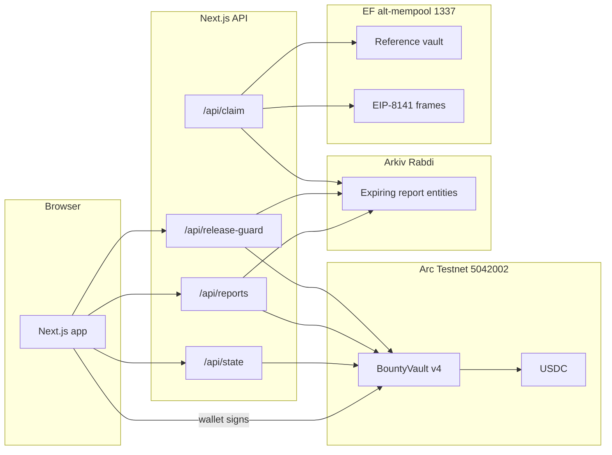
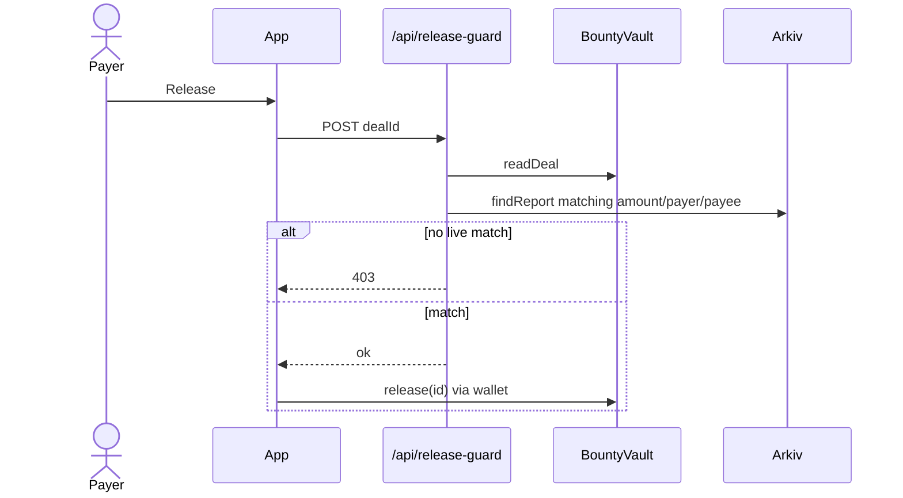
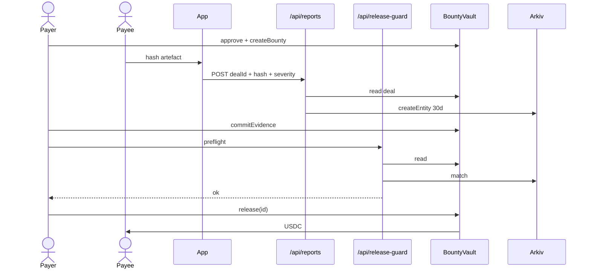

# Building ClearAudit: evidence-gated USDC settlement on Arc

ClearAudit is a settlement rail for situations where custody and trust fail the usual way: one party holds the money, the other party waits, and any proof either never exists or lives forever in someone else's database.

This post walks through the system as shipped for ETHGlobal Mumbai: the Arc vault, the Arkiv fingerprint gate, the Next.js application layer, and the separate EIP-8141 gasless artifact on the EF alt-mempool. It is written for developers who want to understand how the pieces join, not for a marketing deck.

**Live product network:** Arc Testnet, chain id `5042002`  
**Live vault (v4):** [`0x9D500710df8036e4BdF38Bf9A6CA7364Cd4e26C1`](https://explorer.testnet.arc.io/address/0x9D500710df8036e4BdF38Bf9A6CA7364Cd4e26C1)  
**Public re-run (no wallet):** `/evidence?dealId=0`

---

## The problem in engineering terms

You need three properties at once:

1. **Custody that neither party can redirect.** The payee is fixed on chain. `release(id)` takes no recipient.
2. **A payout justification that is not "trust my server."** A third party must be able to re-query the evidence.
3. **A retention window that is not a cron job.** Sensitive artefacts (exploit recovery proofs, disclosure fingerprints, NDA deliverables) should stop being queryable after a fixed period.

ClearAudit maps those to Arc (custody), Arkiv (expiring public fingerprint), and a fail-closed application gate that joins the two before a wallet is asked to sign.

Bug bounties and freelance invoices can run on the same rail. The motivating cases are incident-shaped: recovery after an exploit, coordinated disclosure, retainer milestones, agent dispatch, contest awards.

---

## Architecture



Important separation: **Arc is the product.** The EF path is a research artifact on chain `1337`. It is not a bridge. No value or state moves between the two networks.

### Where each byte lives

| Data | Location | Lifetime |
| --- | --- | --- |
| Escrowed USDC, payee, amount, status | `BountyVault` on Arc | Until released, refunded, or resolved |
| On-chain evidence fingerprint | `evidenceHash` / `evidenceExpiresAt` on the vault | Until expiry or terminal status |
| Report / artefact body | Browser (optional local encryption) | User-controlled |
| Public fingerprint + deal metadata | Arkiv entity on Rabdi | 30 days, then unserved |
| Relayer keys, Arkiv writer key | Server env only | Never `NEXT_PUBLIC_` |

---

## The vault: `BountyVault` v4

The contract is immutable: no proxy, no admin withdrawal, no fee switch. Settlement token is Arc USDC (`0x3600…0000`). The arbitrator address is fixed in the constructor.

### Deal shape

```solidity
struct Deal {
    address payer;
    address payee;
    address token;
    uint128 amount;
    uint64 deadline;
    uint64 claimedAt;
    Status status;
    bool agentMode;
    bool assigned;
    address arbitrator;
    bytes32 criteriaHash;
    bool contestMode;
}
```

Three creation modes share that struct:

- **Named payee** via `createBounty` (classic escrowed payout).
- **Open task** via `createOpenTask` (first `claimTask` wins the payee slot; deadline required).
- **Contest** via `createContest` (many entrants; arbitrator `award`s shares that sum to the escrow).

### Funding a named deal

```solidity
function createBounty(
    address payee,
    uint128 amount,
    uint64 deadline,
    bytes32 criteriaHash
) external returns (uint256 id) {
    if (payee == address(0)) revert ZeroAddress();
    if (payee == msg.sender || payee == arbitrator || msg.sender == arbitrator) {
        revert RoleConflict();
    }
    // ...
    id = nextDealId++;
    deals[id] = Deal({ /* payer: msg.sender, assigned: true, contestMode: false, ... */ });
    _pull(msg.sender, amount);
    emit BountyCreated(id, msg.sender, payee, amount, deadline, criteriaHash, false);
}
```

`RoleConflict` keeps funder, payee, and arbitrator distinct. Tokens are pulled only after the deal row is written so a failed transfer rolls the id back.

### On-chain evidence gate

Arkiv is not called from Solidity. The vault stores a fingerprint the application layer must keep consistent with Arkiv:

```solidity
function commitEvidence(uint256 id, bytes32 hash, uint64 expiresAt) external {
    Deal storage deal = deals[id];
    if (msg.sender != deal.payer) revert OnlyPayer();
    if (deal.status != Status.Open) revert BountyNotOpen();
    if (deal.payee == address(0) && !deal.contestMode) revert PayeeNotSet();
    if (hash == bytes32(0)) revert ZeroAmount();
    if (expiresAt <= block.timestamp) revert EvidenceExpired();
    if (evidenceHash[id] != bytes32(0)) revert AlreadyCommitted();

    evidenceHash[id] = hash;
    evidenceExpiresAt[id] = expiresAt;
    challengeUntil[id] = uint64(block.timestamp) + challengeWindow;
    emit EvidenceCommitted(id, hash, expiresAt, challengeUntil[id]);
}
```

Release refuses without live evidence:

```solidity
function release(uint256 id) external {
    Deal storage deal = deals[id];
    if (msg.sender != deal.payer) revert OnlyPayer();
    if (deal.status != Status.Open) revert BountyNotOpen();
    if (deal.contestMode) revert NotContest();
    if (deal.payee == address(0)) revert PayeeNotSet();
    _requireLiveEvidence(id);

    deal.status = Status.Released;
    _pay(deal.payee, deal.amount);
    emit BountyReleased(id, deal.payee, deal.amount);
}
```

After the challenge window, `settleAfterChallenge` lets anyone pay the recorded payee if evidence is still live and the deal was not disputed. Contests skip single-payee `release` and use `award(winners, amounts)` instead (amounts must sum to the escrow; winners must have entered).

Live deployment uses a **300 second** challenge window so demos can settle without waiting a day.

---

## Arkiv: the fingerprint that expires

Network: Rabdi testnet. Schema: `bounty_reports`.

Indexed fields matter. Arkiv does not error on an unindexed filter; it simply matches nothing. The gate query always starts from indexed columns:

```ts
const page = await client.query(
  [
    "kind = str('zero_day_report')",
    `chainId = u64(${chainId})`,
    `dealId = u64(${dealId})`,
  ].join(" AND "),
  {
    select: {
      $key: true,
      $expiresAt: true,
      protocolWallet: true,
      whitehatWallet: true,
      amount: true,
      encryptedPayloadHash: true,
      criteriaHash: true,
    },
    limit: 100,
  },
);
```

Entity creation (server-only writer key):

```ts
await client.createEntity(
  ReportSchema,
  {
    kind: str("zero_day_report"),
    chainId: u64(BigInt(input.chainId)),
    dealId: u64(input.dealId),
    protocolWallet: addr(input.protocolWallet),
    whitehatWallet: addr(input.whitehatWallet),
    amount: u64(input.amount),
    encryptedPayloadHash: str(input.encryptedPayloadHash),
    severity: str(input.severity),
    expiresAt: u64(expiresAt),
    criteriaHash: str(input.criteriaHash ?? `0x${"00".repeat(32)}`),
  },
  { expiration: ExpirationTime.fromDays(30) },
);
```

The report body never goes on Arkiv. Only the hash does. `ExpirationTime.fromDays(30)` is enforced by the storage layer: after expiry the entity stops being served whether or not ClearAudit's servers are running.

### Join key collision across vault generations

`dealId` restarts at zero on each new vault deployment, but Arkiv entities are keyed by `(chainId, dealId)`. When v4 reused deal ids that v3 had already anchored, a naive `entities[0]` pick returned the wrong amount. The gate now selects the entity whose payer, payee, and amount match the **live** vault row, and fails closed if none match.

Track notes (schema, rationale, friction): [`arkiv/`](../arkiv/).

---

## Application gate: fail closed before the wallet signs

`POST /api/release-guard` is deliberate application policy. The vault cannot call Arkiv. The UI therefore refuses to ask for a signature unless the independent check passes.

Flow:



Pseudocode of the admission test:

```ts
const deal = await readDeal(dealId);
if (deal.status !== Open || deal.payee === zero) return 409;

const report = await findReport(dealId, ARC_CHAIN_ID, {
  amount: deal.amount.toString(),
  payer: deal.payer,
  payee: deal.payee,
});
if (!report) return 403; // no live matching anchor
if (expired(report)) return 403;
if (report.whitehatWallet !== deal.payee) return 403;
if (report.protocolWallet !== deal.payer) return 403;
if (report.amount !== deal.amount.toString()) return 403;
if (!criteriaMatches(deal.criteriaHash, report.criteriaHash)) return 403;

return { ok: true };
```

`/evidence` runs the same join in public, with no wallet. That page is the demo judges can re-run themselves.

`POST /api/reports` derives payer, payee, and amount from the chain before writing Arkiv, so a client cannot anchor a fingerprint that describes a different beneficiary than the vault will pay.

---

## Frontend surface

| Route | Role |
| --- | --- |
| `/` | Mechanism and situations |
| `/app` | Workspace; live deals labeled by criteria hash |
| `/app/rewards` | Fund named / open / contest; claim; commit; release; award |
| `/evidence` | Public gate re-run |
| `/app/gasless` | EF EIP-8141 demo (devnet) |

Stack: Next.js 16, wagmi/viem, Privy for wallet session. Cache Components is on; routes that hit live RPC (for example `/evidence`) stream uncached work inside `<Suspense>` so navigation is not blocked.

Reads go through `/api/state` (vault + optional evidence + Arkiv writer status). Writes are user-signed against the vault ABI. The server never signs product releases for a user.

---

## EIP-8141 path (EF track)

On Arc, the payee of a named deal already never transacts. The EF artifact pushes the same idea on the Alternative Mempool (chain `1337`):

- Build a frame transaction with `@forshtat/hegota-support`.
- Researcher appears only as beneficiary in calldata, never as `tx.sender`.
- Same Arkiv gate runs before any frame is submitted (`POST /api/claim`).

Honesty on the revision we probed: a contract paymaster cannot sit in a PAYMENT frame. Gas is paid by the protocol relayer as `tx.sender`. We do not claim ERC-4337 sponsorship on Arc. The Arc vault's wired `USDCPaymaster` from earlier experiments is unused on the product path; v4 `paymaster()` is zero.

---

## End-to-end happy path (named deal)



Seed deals on the live vault (recovery, disclosure, retainer, open task, awarded contest) are recorded in [`deployments.arc.json`](../deployments.arc.json).

---

## Local development

```bash
npm install
npm --prefix frontend install
cp frontend/.env.example frontend/.env.local   # fill ARKIV_* and PROTOCOL_PRIVATE_KEY
npm run build
npm run verify:chain
npm --prefix frontend run dev
```

`npm run verify:chain` is read-only against public Arc RPC: code presence, deploy receipt, arbitrator, challenge window, contest selectors, deal #0 shape. It does not trust the JSON file blindly.

Foundry tests:

```bash
forge install foundry-rs/forge-std
forge test --match-path 'contracts/test/BountyVault*.t.sol'
```

---

## What we are not claiming

- Not a bounty marketplace or discovery network.
- Not a recovery firm or CERT.
- Not ERC-4337 gas sponsorship on Arc.
- Not a bridge between Arc and the EF alt-mempool.
- The application gate is fail-closed policy. A caller who talks to the vault directly still needs `commitEvidence`; they can skip the Arkiv HTTP check unless they run their own gate.

---

## Further reading in this repo

- Product overview and partner framing: [`README.md`](../README.md)
- Arkiv schema and track notes: [`arkiv/`](../arkiv/)
- Threat table: [`SECURITY.md`](../SECURITY.md)
- Contract sources: [`contracts/BountyVault.sol`](../contracts/BountyVault.sol)
- Deployments: [`deployments.arc.json`](../deployments.arc.json)

If you re-run one thing after cloning, make it `/evidence?dealId=0` against a running app pointed at the live vault. That is the whole thesis in one page: custody on Arc, fingerprint on Arkiv, match or no payout.
